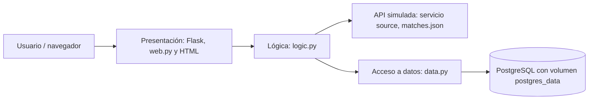

# Laboratorio 5 — Pregunta 1: predicciones de Champions League

Aplicación sencilla de tres capas. Usa partidos **simulados** para practicar el flujo sin depender de una API externa. Las fechas y encuentros son datos de ejemplo, no un calendario oficial.

## Arquitectura y flujo de datos



Al iniciar, la capa de lógica consume `http://source:8080/matches.json`, crea las tablas y guarda o actualiza todos los partidos. La página lee los partidos desde PostgreSQL. Al enviar un marcador, la lógica determina el ganador o empate, valida los goles y el acceso a datos guarda la predicción vinculada al partido. La misma página consulta todas las predicciones.

## Instalación y ejecución local

1. Instalar Docker Desktop y abrirlo.
2. Copiar `.env.example` a `.env` y cambiar `POSTGRES_PASSWORD`.
3. En esta carpeta ejecutar `docker compose up --build -d`.
4. Abrir `http://localhost:8000` (o el puerto definido en `APP_PORT`).
5. Consultar `docker compose ps` y `docker compose logs web` para verificar los servicios.
6. Para detener: `docker compose down`. El volumen conserva los datos. Para borrar también los datos: `docker compose down -v`.

## Variables

`APP_PORT` define el puerto local. `POSTGRES_USER`, `POSTGRES_PASSWORD` y `POSTGRES_DB` configuran la base. `IMAGE_NAME` define el nombre de la imagen web. `MATCHES_API_URL` se configura en Compose con la dirección del servicio fuente.

## Publicación de imagen

Después de iniciar sesión en un registro, definir `IMAGE_NAME` en `.env`, por ejemplo `ghcr.io/USUARIO/lab5-champions:1.0`, y ejecutar:

```powershell
docker compose build web
docker push ghcr.io/USUARIO/lab5-champions:1.0
```

No se deben publicar `.env` ni contraseñas en el repositorio.

## Despliegue cloud

En una máquina virtual de AWS, Azure o Google Cloud con Docker Compose instalado: clonar el repositorio, crear `.env` con una contraseña propia, abrir el puerto configurado en el firewall, definir `IMAGE_NAME` con la imagen publicada y ejecutar `docker compose up -d`. La carpeta conserva el archivo Compose y el volumen `postgres_data` mantiene los registros. Para un entorno público real se recomienda HTTPS y restringir el acceso a la aplicación.

## Evidencias recomendadas

1. Dockerfile completo.
2. `docker-compose.yml` con `web`, `source`, `db` y el volumen, y `.env.example` con nombres de variables sin secretos.
3. Terminal con `docker compose ps` y servicios activos.
4. Navegador con tres partidos cargados.
5. Formulario completado antes de guardar una predicción.
6. Predicción guardada y visible en la tabla.
7. Consulta SQL de partidos y predicciones en PostgreSQL.
8. Predicción conservada después de reiniciar los contenedores.
9. Página del registro con la imagen publicada y su etiqueta.
10. Consola cloud con la VM activa y página accesible por su IP pública.

## Limitaciones de esta práctica

Los partidos son simulados. La aplicación es una demostración académica: no incluye cuentas de usuario ni seguridad para exposición pública sin ajustes adicionales.
